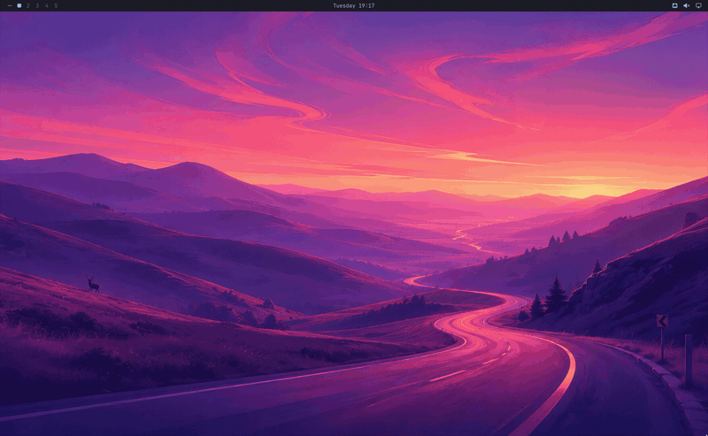
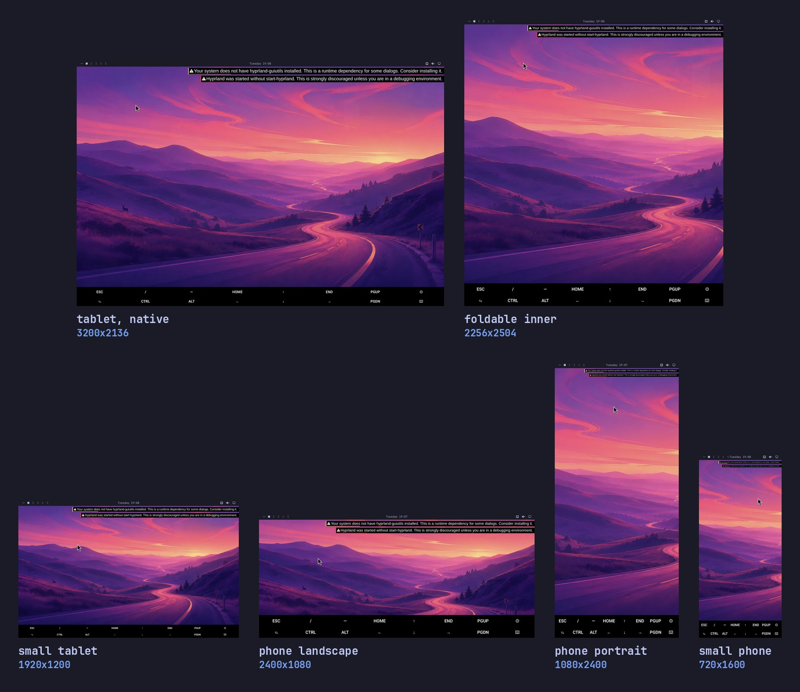
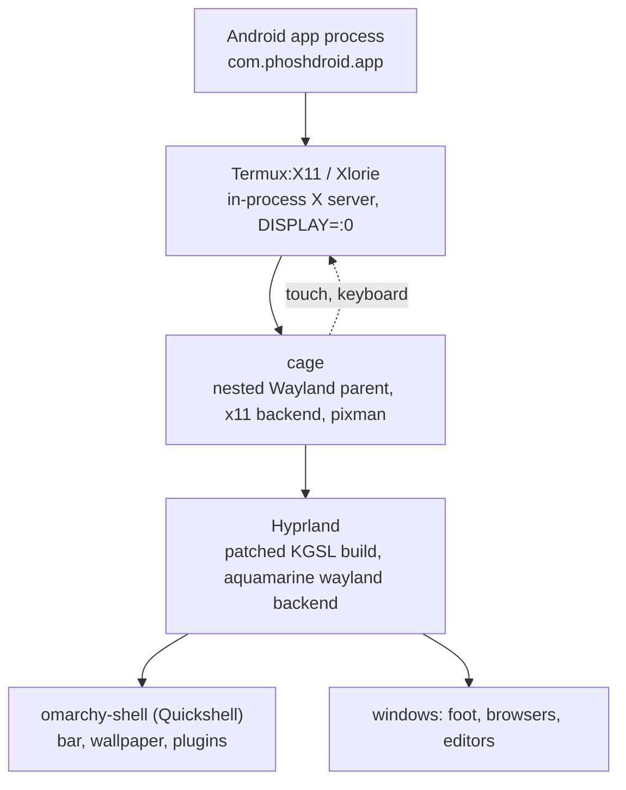
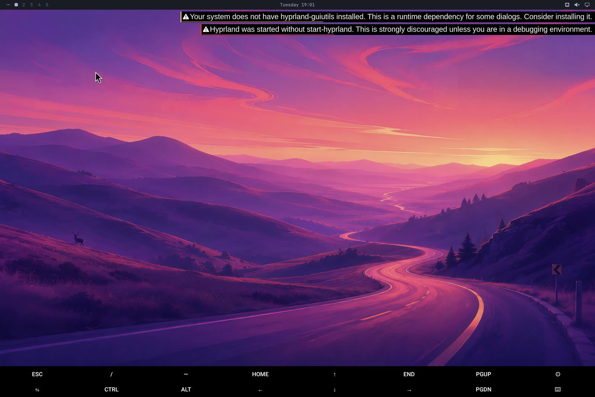

<p align="center">
  <picture>
    <source media="(prefers-color-scheme: dark)" srcset="docs/brand/omdroid-logo-dark.svg">
    <source media="(prefers-color-scheme: light)" srcset="docs/brand/omdroid-logo-light.svg">
    
  </picture>
</p>

# Omdroid

**Omarchy on unrooted Android, in a single APK.**

Omdroid runs Arch Linux ARM with [Omarchy](https://omarchy.org) -- Hyprland plus the
Quickshell-based Omarchy shell -- inside an ordinary Android app. It is not a native
compositor and not a virtual machine. An X server embedded in the app hosts
[cage](https://github.com/cage-kiosk/cage), cage hosts Hyprland as a nested Wayland
compositor, and Hyprland runs the shell and your windows. The whole guest runs through
[proot](https://proot-me.github.io/) as an unprivileged user inside the app's data
directory, so nothing needs root, an unlocked bootloader or Magisk.



The recording was taken on the test tablet from inside the session, through Hyprland's
own screencopy at about 3.6 frames per second (`docs/omarchy/tools/demo-capture.sh`), so
it shows what the compositor draws. Android's side -- the splash and the extra-key bar
under the desktop -- is not in it; the screenshots further down are Android's own.

## Status

Alpha, and honest about it. It has been run on exactly one device: a Xiaomi Pad 8 Pro
(model 25091RP04G), Android 16 with HyperOS 3.0, a Snapdragon SM8750P with an Adreno GPU,
a 3200x2136 panel and 12 GB of RAM. No Omarchy build has been released -- the releases on
this repository are the older Phoshdroid builds, and this branch is built from source.

| Claim | How it was measured | Result | Row |
| --- | --- | --- | --- |
| A cold start hands over to the desktop by itself, five times in a row | `coldstart.sh 5`, which launches the app the way the launcher icon does and times every run from the launch | hand-over unaided 5/5 at 2.9-3.0 s, the desktop already drawn at 2.4-2.5 s (bar and wallpaper up, all sizes agreeing), no restart, no foreign activity | D2 |
| A cold start opens no Android settings page | every activity on top during those five runs | only `LauncherActivity`, then `com.termux.x11.MainActivity` | D2 |
| The geometry on the tablet's own panel | `probe.sh` plus a row scan of the screenshot | X root 3200x1971, cage window 3200x1970, monitor 3200x1970 at 120 Hz with scale 2 (logical 1600x985), bar 26 px, background 1600x985, first black row below the desktop | D3 |
| Tapping the icon again while the desktop runs | two rounds, display activity timed and the process checked | display on top in 0.0 s and 0.1 s, same app process, one Hyprland | D4 |
| Rotating while the app is in the background | `screen.sh rot` both ways, probe after each change | `VERDICT: PASS` +5.3 s each way, same process, the open `foot` window still listed | D5 |
| Rotating, resizing and resetting in the foreground | four changes in a row, probe after each and again 4 s later | `VERDICT: PASS` in +2.6 to +2.7 s each, same process, `foot` still open | D6 |
| Seven screen sizes, from a small phone to the native panel, including an odd height | one cold start per row with the display overridden | 7/7 PASS, hand-over unaided 2.6-3.2 s, X root equal to the prediction, monitor equal to the root rounded down to even | D7 |
| A live size change is followed by restarting only the shell | guest watcher log and the layer sizes after the change | background layer back at the new logical size 2.4 s later, the open window stayed open | G4 |

Rows D2-D7 are in `docs/omarchy/r3-device-report.md`; row G4 is in
`docs/omarchy/r2-guest-report.md`. The D rows were measured on the first build that
combined the rewritten app and the rewritten guest session, made just before the round 3
host changes listed under "Not verified yet" went in.



These are Android screenshots of six of the seven cold starts in row D7, to scale. Only
the first is the tablet's own panel; the others are emulated on it with Android's display
overrides (`screen.sh`). The two banners at the top right are Hyprland's own start-up
warnings; see Known limits.

Not verified yet:

- Screen off and on, and the keyboard and touch path, with this build: rows D8 and D9
  are blocked. The tablet fell to its PIN keyguard on wake and the display stayed behind
  it; the session itself survived (same process, probe passing, window still open).
- The round 3 host work -- one launch decision, session-end reporting, the error screen,
  guest scripts travelling inside the APK, and the names the user sees -- is unit-tested
  only (H10-H15); it has not been run on a device.
- A foldable phone. It has never been tried.

## How it works



Three constraints shape the stack:

- **No DRM node.** An Android app gets no `/dev/dri`, so a VRAM-backed compositor cannot
  start. Hyprland has no X11 backend either (aquamarine offers DRM, nested Wayland,
  headless and null), so something must be Hyprland's parent and speak X11 to the app.
- **No SysV shared memory.** weston's X11 backend dies here with `x11shm: failed to
  allocate SHM segment`, because Android blocks `shmget`; cage (wlroots) presents through
  the X Present extension instead, on the pixman renderer.
- **No systemd.** proot cannot be PID 1, so Hyprland is exec'd directly under
  `dbus-run-session` with a restricted session bus, and the Omarchy user units never start.

The launch is a handshake, not a timer. In order:

1. The app wipes `<prefix>/tmp/omarchy-runtime/`, the guest's `XDG_RUNTIME_DIR`, and
   the stale proot sockets of the previous run. Nothing in it is meant to survive a
   session: a leftover plugin scan file makes the shell read the previous session's
   plugins.
2. The app starts the X server, then the proot guest with `/etc/phoshdroid/start.sh`.
   No host-side Wayland compositor is started.
3. `start.sh` builds the shell's plugin index, removes a stale ready marker, starts the
   resize helper and the watcher, and execs `dbus-run-session ... cage --
   session-child.sh`.
4. `session-child.sh` waits, bounded and with no fixed sleep, until cage's window equals
   the X root, then execs Hyprland. Hyprland's own configuration starts the shell.
5. The watcher writes `$XDG_RUNTIME_DIR/omarchy-ready` once Hyprland answers, has one
   monitor equal to the X root, and the `omarchy-bar` and `omarchy-background` layers
   fit it.
6. The app waits for that marker -- with a 25 s fallback for an older guest image, a
   hard cap of 120 s, and an immediate give-up if the session process died -- and only
   then brings the display activity to the front.



The X root is the only authority on the screen size. The app predicts it before the
surface exists and passes it as a hint; the guest never trusts the hint over the root.
An odd root is normal -- 3200x1971 on the tablet, because the extra-key bar takes the
rest -- and the guest rounds each side down to even for cage's window, so the logical
size stays integral at scale 2 and the spare pixel row stays black. Rotation, folding
and the extra-key bar change the root while the session runs: no session restart and no
user action, only the shell restarts, which blinks the bar and the wallpaper for about
2-3 s. Scale is 1 or 2; the guest quantises a fractional request (1.5 comes out as 1.6),
so the app offers integers only.


## Requirements

- Android 12 (API 31) or newer, arm64.
- A Qualcomm Adreno GPU for the accelerated path (Mesa KGSL). Without it the guest
  falls back to software rendering (`swrast`/`pixman`); there is no virgl route,
  because the payload contains no `virpipe` driver.
- About 6.5 GB free in the app's private storage. The APK carries a 1.6 GB gzipped
  guest image that expands to about 4 GB (76,382 files), and the app refuses to extract
  when less than 6.5 GB is available.
- Sideloading: the APK is about 1.7 GB, which puts it out of Play's reach. The Android
  package id is still `com.phoshdroid.app`; renaming it is a separate, upgrade-breaking
  change.

## Build and install

```bash
git clone --recursive https://github.com/zweck/omdroid.git
cd omdroid
git config core.hooksPath .githooks     # optional: pre-push runs the unit tests

# Guest image. Downloads the pinned upstream bundle (~1.2 GB), verifies its
# sha256, applies the guest overlay, unpacks cage/wlroots/libliftoff from
# Arch Linux ARM, and writes a gzipped tar. Needs ~6 GB free; no root.
./rootfs/package-omarchy-rootfs.sh

# Termux prefix and the host binaries that must live in jniLibs.
./rootfs/build-bootstrap.sh

# Repack the guest, build the APK, run the unit tests. --no-repack skips the first step.
./docs/omarchy/tools/build-chain.sh
```

The toolchain is JDK 17, Gradle 8.11.1, AGP 8.7.3 and Kotlin 2.1.0, with
`compileSdk`/`targetSdk` 35, `minSdk` 31 and NDK 27.2.12479018.

The CI gate is `./gradlew :app:lintDebug` and `./gradlew :app:test`. CI does not
assemble the APK, because the guest asset is too large for it.

Four packaging notes. The guest packager caches the upstream bundle in
`~/omarchy-payload` (override with `OMARCHY_PAYLOAD_DIR`), so it is not tied to one
machine; the pmOS-era `rootfs/package-rootfs.sh` and `rootfs/build-rootfs.sh` are still
in the tree but not part of this build. Only the debug variant is usable:
`compressReleaseAssets` runs out of memory on the multi-gigabyte asset, and a release
build signs with the debug keystore. Delete the old APK before assembling after an asset
change, or the package step appends to it and the next APK is twice the size;
`build-chain.sh` does that for you.

HyperOS and MIUI refuse `adb install` with `INSTALL_FAILED_USER_RESTRICTED`.
`docs/omarchy/tools/install.sh` pushes the APK to `/sdcard/Download` and drives
Android's own package installer by tapping the buttons it finds by their text, then
compares the installed APK's sha256 with the local file. App data survives, so it is an
update; the 1.7 GB push takes a few minutes.

## Developing and debugging on a device

Every script takes the device from the `TABLET_SERIAL` environment variable (its adb
serial) and stops if it is not set, so a second attached device is never picked by
accident. The scripts are in `docs/omarchy/tools/`.

| Tool | What it does |
| --- | --- |
| `probe.sh` | One adb round trip: prints the X root, cage's window, the Hyprland monitor, every layer surface, the client count and the ready marker, then `VERDICT: PASS` or the link in the chain that is wrong. |
| `coldstart.sh` | Cold-starts the app the way the launcher icon does, times the hand-over and the desktop per run, and screenshots each run. |
| `screen.sh` | Emulates other screens with Android's own overrides: `set <W>x<H> <dpi>`, `rot <0\|1\|2\|3\|auto>`, `reset`, `show`. |
| `hc.sh` | hyprctl against the live session from a second proot, including `dispatch`. |
| `sx.sh` | Runs a shell command inside the live session: same proot, session bus, Wayland socket. |
| `gx.sh` | Runs a shell command in the guest as uid 1000, with no live session needed. |
| `gpush.sh` | Copies one file into the extracted guest. |
| `shot.sh` | Screenshots the tablet and prints numbers that judge the result without eyes. |
| `install.sh` | Sideloads through the on-device installer and proves the installed APK is the local one. |
| `demo-capture.sh` | Records a short demo from inside the session with grim; works with the device locked. `demo-gif.sh` turns the frames into a GIF. |
| `build-chain.sh` | Repacks the guest image, checks the overlay scripts inside it, assembles the APK, runs the unit tests. |

## Project layout

- `app/` -- the Kotlin app: launcher, asset extraction, proot service, settings.
- `rootfs/` -- the guest packager `package-omarchy-rootfs.sh` and the overlay copied into
  the guest: `start.sh`, `session-child.sh`, `fit-x11.py`, `omarchy-watch.py`,
  `omarchy-plugin-index.sh` and the fake `/proc` files.
- `termux-x11/` -- the Xlorie X server; `termux-app/` -- emulator and shared libraries.
  Both are submodules on the `phoshdroid-integration` branch.
- `docs/omarchy/` -- architecture, the launch contract, the payload audit, the reports and the tools;
  `docs/brand/` -- the logo generator and its outputs.

## Branding

The mark is concept A: an Android-style head with two antenna stubs inside a square
frame that has a single break in its bottom edge, next to a heavy block wordmark.
Everything is generated from ASCII bitmaps by `docs/brand/build_brand.py`, which writes
the SVGs, the PNGs, the contact sheets, the staged Android icon resources and the
terminal version. The app's launcher icon in `app/src/main/res/drawable/` and
`app/src/main/res/mipmap-anydpi-v26/` comes from the same shapes. The files are in
`docs/brand/`: `omdroid-logo-dark.svg`, `omdroid-logo-light.svg`, `omdroid-icon.svg`
and `omdroid-logo.txt`, which is the version for a terminal:

```
▄███████▄  ██████   ██████  ███████▄   ███████▄   ▄███████▄  ███  ███████▄
███▀▀▀███  ███ ███ ███ ███  ███▀▀▀███  ███   ███  ███▀▀▀███  ███  ███▀▀▀███
███   ███  ███  █████  ███  ███   ███  ███▀███▀   ███   ███  ███  ███   ███
███▄▄▄███  ███   ███   ███  ███▄▄▄███  ███  ███   ███▄▄▄███  ███  ███▄▄▄███
▀███████▀  ███   ███   ███  ███████▀   ███   ███  ▀███████▀  ███  ███████▀
```

## Known limits

- The Android package id is still `com.phoshdroid.app`, the name it had as Phoshdroid.
  Changing it is an upgrade-breaking change, so it waits.
- There is no systemd inside the guest. proot cannot be PID 1, so the Omarchy user
  units never start, and NetworkManager, polkit and every command that calls
  `systemctl` fail. The desktop, the bar and the wallpaper do not depend on them.
- The bar's audio widget has no data: no `omarchy-proot-audio` binary exists in the
  payload. The PulseAudio-to-Android bridge is designed, never demonstrated.
- Scale 1.5 is not accepted by this Hyprland build; the guest quantises it to 1.6, so
  the app offers 1 and 2.
- A live size change, including a rotation, blinks the bar and the wallpaper for about
  2-3 s while the shell restarts. The session and its windows survive.
- Every start shows two Hyprland warning banners at the top right for a few seconds: one
  says `hyprland-guiutils` is not installed, the other that Hyprland was started without
  `start-hyprland`. They are in every cold-start screenshot above and are not yet
  silenced.
- Tools that walk `/sys/devices` do not run: Android denies the app that directory, and
  `btop` aborts on it with `Permission denied [/sys/devices]`. `/proc/stat`, `meminfo`,
  `loadavg`, `uptime` and `cpuinfo` are static stand-ins, so load and memory figures
  read from them are not live.
- A change of display density while the app runs (Android's display-size setting) keeps
  the bottom gap computed at launch: a 52 px black strip stays between the desktop and
  the extra-key bar until the next launch (finding F2 in the round 3 device report).
- The Termux prefix still installs an unused weston and its library closure
  (`rootfs/build-bootstrap.sh`); nothing starts it any more. It is dead weight in the
  APK until the prefix is rebuilt without it.

## Troubleshooting

**The bar is empty and there is no wallpaper.** In proot mode Quickshell reads a plugin
index file instead of scanning the filesystem, and upstream only writes that file when
`uname -r` mentions PRoot, which proot-distro does not. Our session script builds it
before the shell starts. A plugin installed during a session does not appear until the
next session, because the index is built once per start.

A cold start used to stop on Android's all-files access page instead of the desktop;
that is fixed (row D2), and the page is now requested only from the settings screen, by
the `Mount /sdcard` switch.

## Credits

Omdroid stands on work done by other people:

- [**BlackFireAlex/omarchy-android**](https://github.com/BlackFireAlex/omarchy-android)
  -- the Arch Linux ARM guest payload and the patched Hyprland, aquamarine and Mesa
  builds. Its bundle ships an MIT licence.
- [**Omarchy**](https://omarchy.org) -- the shell, themes and commands the guest runs;
  [**Quickshell**](https://quickshell.org) -- the QML toolkit that shell is built on.
- [**Termux:X11**](https://github.com/termux/termux-x11) -- the in-process X server, GPLv3.
- [**Termux**](https://github.com/termux/termux-app) -- terminal emulator and shared libraries, GPLv3 only.
- [**cage**](https://github.com/cage-kiosk/cage) and
  [**wlroots**](https://gitlab.freedesktop.org/wlroots/wlroots) -- the nested parent compositor.
- [**proot**](https://proot-me.github.io/) -- the unprivileged-root trick that makes the stack possible.
- [**Arch Linux ARM**](https://archlinuxarm.org) -- the guest distribution.

Omdroid is not affiliated with Omarchy, Hyprland, Termux or any of the projects above.

## Licence

The code in this repository is MIT licensed; see [`LICENSE`](LICENSE). The bundled
guest image and the Termux submodules keep their own licences.
