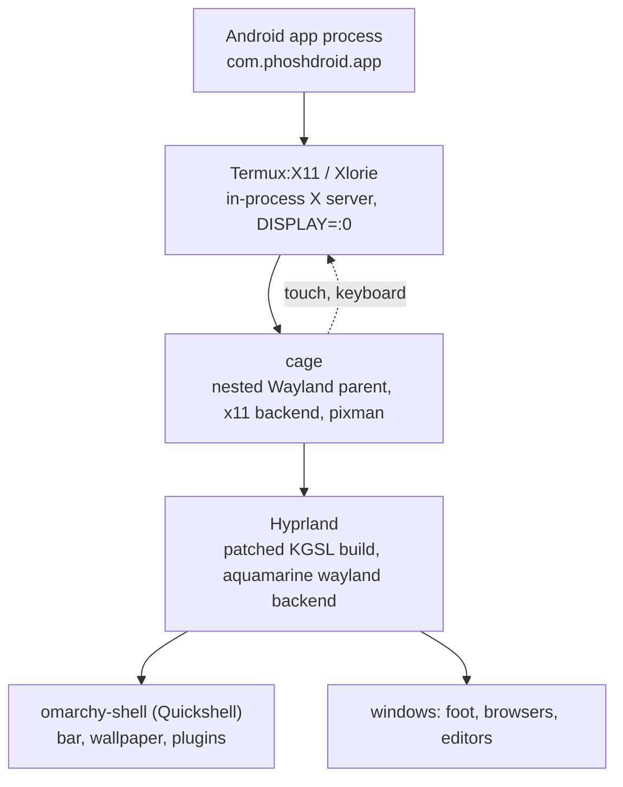
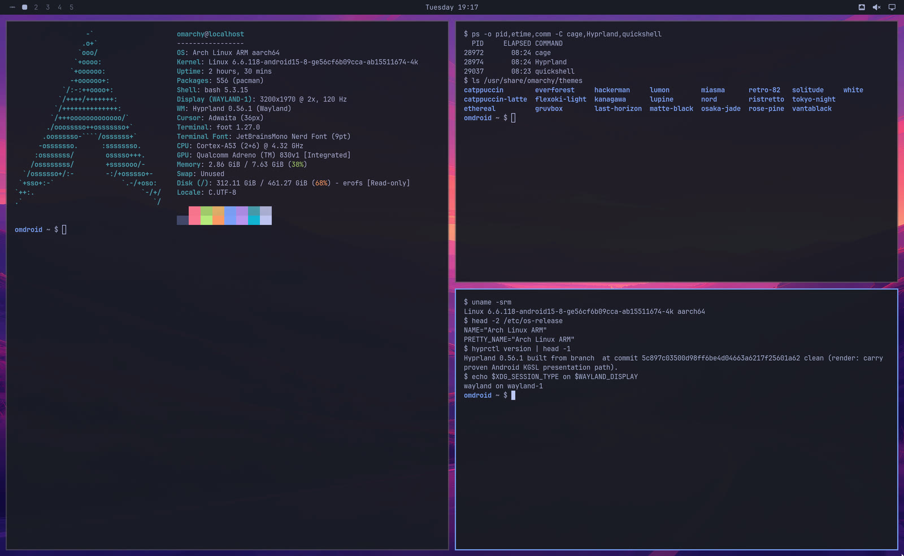

<p align="center">
  <picture>
    <source media="(prefers-color-scheme: dark)" srcset="docs/brand/omdroid-logo-dark.svg">
    <source media="(prefers-color-scheme: light)" srcset="docs/brand/omdroid-logo-light.svg">
    
  </picture>
</p>

# Omdroid

**Omarchy on unrooted Android, in a single APK.**

> [!WARNING]
> **Highly experimental.** Omdroid has been measured on one tablet and used by hand on one phone.
> The latest build is the
> [`v0.0.19-alpha`](https://github.com/zweck/omdroid/releases/tag/v0.0.19-alpha) pre-release: the
> running desktop uses about 12 % of a core at idle instead of about 155 %, the first start
> extracts the guest in 104 s instead of 284 s, the APK is 1.1 GB instead of 1.7 GB, and a new
> Graphics setting chooses Auto, Adreno GPU (KGSL) or Software. It has been installed
> on the tablet as an update over the earlier builds and cold-started, never as a clean install. Most measurements come
> from injected input; docking was also tried by hand with a real USB-C dock, monitor, keyboard
> and trackpad. Expect breakage. The guest lives in the app's private storage, so
> uninstalling the app or clearing its data deletes everything inside it.

Omdroid runs Arch Linux ARM with [Omarchy](https://omarchy.org) -- Hyprland plus the
Quickshell-based Omarchy shell -- inside an ordinary Android app. It is not a native
compositor and not a virtual machine. An X server embedded in the app hosts
[cage](https://github.com/cage-kiosk/cage), cage hosts Hyprland as a nested Wayland
compositor, and Hyprland runs the shell and your windows. The whole guest runs through
[proot](https://proot-me.github.io/) as an unprivileged user inside the app's data
directory, so nothing needs root, an unlocked bootloader or Magisk.


The recording was taken on the test tablet from inside the session, through Hyprland's
own screencopy at about 3.6 frames per second (`docs/omarchy/tools/demo-capture.sh`), so
it shows what the compositor draws. Android's side -- the splash and the extra-key bar
under the desktop -- is not in it; the screenshots further down are Android's own.

## Status

Highly experimental. Every measurement below was taken on one device: a Xiaomi Pad 8 Pro
(model 25091RP04G), Android 16 with HyperOS 3.0, a Snapdragon SM8750P with an Adreno GPU,
a 3200x2136 panel and 12 GB of RAM. The owner also runs 0.0.15 on his Samsung foldable phone
(Android 17, Adreno 840) and reports that it works well; nothing on the phone was measured. The
current Omdroid build is the
[`v0.0.21-alpha`](https://github.com/zweck/omdroid/releases/tag/v0.0.21-alpha) pre-release; the
APKs of releases 0.0.13 to 0.0.17 were withdrawn because they embedded a build-machine path
(their notes stay up, `docs/omarchy/r10-release-0.0.18.md`), and the APKs of the Phoshdroid
releases 0.0.1 to 0.0.12 were withdrawn with a note pointing here (their notes stay up too). Releases before `v0.0.14-alpha` are
Phoshdroid builds -- postmarketOS with Phosh, a different guest under the same package id -- so
do not install Omdroid over Phoshdroid: uninstall it first. Installing over it has not been tested.

| Claim | How it was measured | Result | Row |
| --- | --- | --- | --- |
| A cold start hands over to the desktop by itself, five times in a row | `coldstart.sh 5`, which launches the app the way the launcher icon does and times every run from the launch | hand-over unaided 5/5 at 2.9-3.0 s, the desktop already drawn at 2.4-2.5 s (bar and wallpaper up, all sizes agreeing), no restart, no foreign activity | D2 |
| A cold start opens no Android settings page | every activity on top during those five runs | only `LauncherActivity`, then `com.termux.x11.MainActivity` | D2 |
| The geometry on the tablet's own panel | `probe.sh` plus a row scan of the screenshot | X root 3200x1971, cage window 3200x1970, monitor 3200x1970 at 120 Hz with scale 2 (logical 1600x985), bar 26 px, background 1600x985, first black row below the desktop | D3 |
| Tapping the icon again while the desktop runs | two rounds, display activity timed and the process checked | display on top in 0.0 s and 0.1 s, same app process, one Hyprland | D4 |
| Rotating while the app is in the background | `screen.sh rot` both ways, probe after each change | `VERDICT: PASS` +5.3 s each way, same process, the open `foot` window still listed | D5 |
| Rotating, resizing and resetting in the foreground | four changes in a row, probe after each and again 4 s later | `VERDICT: PASS` in +2.6 to +2.7 s each, same process, `foot` still open | D6 |
| Seven screen sizes, from a small phone to the native panel, including an odd height | one cold start per row with the display overridden | 7/7 PASS, hand-over unaided 2.6-3.2 s, X root equal to the prediction, monitor equal to the root rounded down to even | D7 |
| A live size change is followed by restarting only the shell | guest watcher log and the layer sizes after the change | background layer back at the new logical size 2.4 s later, the open window stayed open | G4 |
| A finger tap lands where it is put | `touchlog.c`, a full-screen layer surface that prints every `wl_touch` event, and one `input touchscreen tap` per point | 8/8 taps arrive as `wl_touch`, each within 1 screen px of the tap (a constant -1 px from the X11 hop), no scale and no mirror | touch D3.2 |
| The stock bar reacts to a touch tap | `bartest.py touch 26`, all nine bar targets, one touch tap each | 9/9 react: five workspace switches, the Omarchy menu, three panels. Round 4 measured 0/9 in this mode | touch D3.3 |
| The mobile gestures work as quick swipes, no hold | `input touchscreen swipe`, 100-200 ms per gesture, one DOWN/move stream/UP each | 7/7: back from x=20 and x=3, pill to home, dock to switcher, card flick closes a window, card tap switches, quick-settings pull-down. The dock swipe-up was 0/10 under simulated touch | touch D3.5, mobile R6 |
| Two fingers reach a client as two touch points | a synthetic `uinput` multi-touch device moved two fingers 600 px in 20 steps, `touchlog` reading | ids 0 and 1 down at once, 42 motions, both tracked to the end; pointer emulation could only ever send one | touch D3.7 |
| A hardware keyboard drives Omarchy | a `uhid` HID keyboard through Android InputReader and Termux:X11's key interceptor | SUPER+2/1/3 switch workspaces, SUPER+Return opens `foot`, SUPER+W closes it, Alt+Tab flips focus, Esc reaches the guest; Android's drawer, recents and back never fire | keys K5 |
| Five Omamobile plugins load in the shell | the session's plugin scan file, `omarchy-shell shell listPlugins`, the shell's own log | 5 third-party entries, all five named and `omamobile.bar` active, 0 failed loads and 0 TypeError in 505 log lines | mobile M1, M2 |
| The mobile UI switches to the stock session and back | one cold start per mode, `shell.json` compared with the image's stock file | desktop: stock bar 1600x26, 0 `omamobile` ids, `gaps 5 5 5 5`, 0 plugin links; mobile: 5 links and `gaps 0 0 0 0` | mobile M7 |
| A cold start with the mobile UI hands over by itself | `coldstart.sh`, no nudge | unaided hand-over at +9.7 s, +10.3 s and +11.0 s, desktop PASS each time | touch D1, D3, mobile R7 |
| Plugging in a monitor moves the running desktop there, unplugging brings it back | Android's simulated 1920x1080 display, five dock/undock cycles; then the owner's USB-C dock with a 3440x1440 HDMI monitor | the same X activity moved (no relaunch, same process), X root, cage and Hyprland 1920x1080, desktop UI ready in 2.8-5.9 s, back in the mobile UI on the tablet in 12-30 s, the open `foot` window kept throughout | dock T2-T5 |
| A docked keyboard and mouse drive Omarchy whatever the tablet has focused | `uhid` keyboard and mouse with Android Settings focused on the tablet; then the owner's Corne keyboard and Magic Trackpad on the dock | typed text reached a terminal on the monitor and not Settings, SUPER+Return opened a terminal there, the pointer moved, left and right click and the wheel reached a client; unplugging gave both back to Android within 0.5 s. The owner's real dock: confirmed working | input I2-I4 |
| `sudo` runs as fake root | `sudo id` in the live session; the device's own proot running the previous broker as a control | `uid=0(root)`, `sudo pacman -Q pacman` exit 0; the control refused every request with `peer is not this app` | sudo device finding 2 |
| `yay` builds and installs an AUR package | first `yay --version`, then `yay -S cbonsai`, run it, `yay -R` | `yay` installed itself in 1 min 28 s, the next call took 0.19 s; after the hard-link repair restored 1,830 files, gcc linked and `cbonsai` was built, run and removed | input I0 |

Rows D2-D7 are in `docs/omarchy/r3-device-report.md`; row G4 is in
`docs/omarchy/r2-guest-report.md`. The `touch` rows are in `docs/omarchy/r5-touch-device-report.md`,
the `keys` rows in `docs/omarchy/r4-input-report.md`, and the `mobile` rows in
`docs/omarchy/r5-mobile-ui-device-report.md`; the `dock` rows are in
`docs/omarchy/r7-dock-device-report.md`, the `input` rows in `docs/omarchy/r8-dock-input-report.md`
and the `sudo` row in `docs/omarchy/r6-sudo-report.md`. The D rows were measured on the first build that
combined the rewritten app and the rewritten guest session, made just before the round 3
host changes listed under "Not verified yet" went in; the later rows come from the round 5
builds, which start in about 10 s rather than 3.


These are Android screenshots of six of the seven cold starts in row D7, to scale. Only
the first is the tablet's own panel; the others are emulated on it with Android's display
overrides (`screen.sh`). The two banners at the top right are Hyprland's own start-up
warnings; see Known limits.

Not verified yet:

- `sudo` beyond `sudo id`, `sudo pacman -Q` and the AUR install `yay` ran: the interactive
  prompt, Ctrl+C and `omarchy-pkg-add` have not been run on a device; the steps are in
  `docs/omarchy/r6-sudo-report.md`.
- Docking on the phone: Samsung DeX, whether a real unplug survives Samsung's teardown, and the
  phone's monitor density. The checklist is in `docs/omarchy/r7-dock-device-report.md`.
- Docking with the round 12 additions: the Android bridge's tiles and the key bar's summon button
  have only been used undocked, on the tablet's own panel; picture-in-picture for that button is
  untested. The keyboard-settings gear was tapped on the 0.0.21 candidate: the preferences screen
  opens with the app's process unchanged. See `docs/omarchy/r12-report.md`.
- A clean install of a release. `v0.0.14-alpha`, `v0.0.15-alpha`, `v0.0.18-alpha` and
  `v0.0.19-alpha` have each
  been installed on the tablet only as an update over an existing guest and cold-started with
  `probe.sh` passing (row T0 in `docs/omarchy/r4-touch-report.md` for 0.0.14). Android refuses
  apps hard links, so a guest extracted before 0.0.14 lacks the image's 1,832 hard-link members
  (terminfo and zoneinfo aliases, `/usr/bin/ld`, `gawk`). The extractor now copies them (checked
  on the build machine: all 76,382 files), and since 0.0.16 an older guest is repaired once at
  session start (`omdroid-repair-links.sh`: 1,830 restored on the tablet, row input I0).
- Real fingers, measured. The owner uses the phone and the tablet by hand, but every measured
  touch was `adb shell input` or a synthetic `uinput` device:
  Android InputReader and Termux:X11 see both like a finger, but with perfect straight-line
  timing. Whether a human tap, flick and long press feel right has not been tried.
- The keyboard cover. Only synthetic `uhid` HID keyboards have been used. The real cover's
  firmware -- which device names it reports, whether its touchpad arrives as a touchpad, and
  whether its Meta key is delivered at all -- is untested; `docs/omarchy/r4-input-report.md`
  ends with the ten-minute checklist.
- Pinch, rotate and three-finger gestures. Two points are proven to reach a client, not what
  an app makes of them, and Hyprland's own touch workspace swipe
  (`gestures:workspace_swipe_touch`) is off in this config and was not enabled.
- The fresh-image path for the patched aquamarine. The packager copies `lib/` and that block
  passes `bash -n`, but no guest image was repacked with it this round; on the device the
  library came from the APK's overlay sync instead (row D3.1 in the touch report).
- The idle lock. At 300 s idle the idle service runs `omarchy-system-lock` and it exits 0,
  yet `omarchy-shell lock isLocked` stays false: under proot the lock timer fires and
  nothing locks.
- Installing Omdroid over an existing Phoshdroid. The package id is unchanged, so the APK
  would replace the installed app; that update has still not been tried. Uninstall
  Phoshdroid first.
- Screen off and on: rows D8 and D9 are blocked. The tablet fell to its PIN keyguard on
  wake and the display stayed behind it; the session itself survived (same process, probe
  passing, window still open).
- Session-end reporting and the error screen (H10-H15) are unit-tested only; the launch
  decision and the guest-overlay sync run on the device in every cold start.
- A foldable phone, measured. The owner runs 0.0.15 on a Samsung foldable and reports it works
  well; folding and unfolding with a session open, and docking it, have not been measured.

## Mobile UI

The guest ships a phone-shaped UI, built from five plugin trees vendored from
[Omamobile](https://github.com/derekross/omamobile) (MIT; the commit, the upstream files and the
local changes are listed in `rootfs/overlay/etc/phoshdroid/omamobile/SOURCE.md`): a 44 px status
bar, a pull-down quick-settings sheet, a dock with an app drawer and a home pill, an edge-swipe
back gesture that sends Escape to the focused window (or goes home from a terminal), and a
recent-apps switcher. Type is 16 px (stock 12), controls are 44 px (stock 28), windows tile with
no gaps, the idle screensaver is off, and the pointer hides after a touch. Only these five are
vendored: each of the others stands on hardware, systemd or a service that proot does not have.

It is the default. The switch is one file, read at each session start, so it applies on the next
start and never mid-session:

```bash
echo desktop > ~/.config/omdroid/ui   # the stock Omarchy session, next start
echo mobile  > ~/.config/omdroid/ui   # the phone UI, next start
rm ~/.config/omdroid/ui               # same as mobile
```

`desktop` puts the stock bar, sizes and gaps back, undoing only the keys and links the switch
wrote. Under proot the switcher's cards are the app's icon and window title rather than live
window copies, because a live copy needs a dmabuf version Hyprland does not offer here. Quick
settings is honest about hardware the guest lacks, and round 12 made two of its tiles real:
Wi-Fi and Bluetooth read Android's own state (three states: on, off, or unknown when the host has
not confirmed the reading), and the Wi-Fi tile opens Android's Wi-Fi settings on the display the
shell is on. Mobile data, torch, fingerprint and the brightness slider stay dimmed with their
reason, while volume, Do Not Disturb, dark theme, clipboard (text), screenshot, rotation,
autorotate and stay-awake work.


Both are Android screenshots of the round 5 build (row R8 in
`docs/omarchy/r5-mobile-ui-device-report.md`).

## Docking

**Working on the tablet with a real USB-C dock, monitor, keyboard and trackpad; untested on a
phone.** The design: plug the phone into a
monitor and the desktop moves there, in the `desktop` UI; unplug it and the session keeps running
while Android is normal again, with the same desktop waiting when you open Omdroid in the `mobile`
UI. Nothing restarts: the monitor is just where the X surface is drawn, and the guest's UI mode is
a file the shell re-reads in place.

- **Plug.** Android reports the display, the app writes `desktop` into the guest's
  `~/.config/omdroid/ui`, the watcher re-applies `omdroid-ui.sh` + the plugin index and restarts
  only the shell (about 2.4 s, windows and session untouched), and the X activity is started on —
  or re-launched onto — the monitor with `setLaunchDisplayId`. The phone screen stays Android. The
  extra-key bar stays hidden until the small button in the desktop's bottom-right corner summons
  it, and, on Android 16.1+, the window asks
  for keyboard capture so <kbd>Super</kbd> reaches Hyprland instead of opening the system's own
  shortcut.
- **Unplug.** Android migrates the window back to the built-in display, the app writes `mobile`,
  the shell switches back in place. The X server and the proot session are in the app's process,
  and the manifest asks Samsung to keep that process alive across the teardown.
- **The pin.** The dock decides by default; `~/.config/omdroid/ui-pin` overrides it, so
  `echo desktop > ~/.config/omdroid/ui-pin` keeps the stock desktop UI on the phone and
  `echo mobile > ~/.config/omdroid/ui-pin` keeps the phone UI on the monitor. `echo auto >` (or
  deleting the file) follows the dock again. `~/.config/omdroid/ui` itself is host-owned while the
  pin is `auto`.
- **Proven on the tablet's simulated display** (`docs/omarchy/r7-dock-device-report.md`): the
  running window moves to the display and back with the session, its windows and its PIDs
  untouched, the desktop takes the display's full size, and SUPER reaches the guest through the
  accessibility service on an Android without the keyboard-capture API.
- **Keyboard and mouse belong to the desktop while docked.** Android keeps its focus and its
  pointer on the built-in screen (HyperOS has no desktop mode: the cursor cannot reach the monitor
  and the monitor never gets focus), so Omdroid's accessibility service takes them instead: every
  physical keyboard (the tablet's keyboard cover too) types on the monitor whatever Android app has
  focus, and every mouse or touchpad drives Hyprland's cursor with relative motion, buttons, the
  wheel and two-finger scroll. The touchscreen and the on-screen keyboard stay Android's, as do
  power, volume, media and brightness keys. Android's own arrow still moves on the tablet screen
  but clicks nothing there. Undocking, a stopped app, the lock screen or Samsung DeX (whose
  pointer reaches the monitor by itself) hand everything back to Android at once. Proven with a
  synthetic USB keyboard and mouse on the simulated display (`docs/omarchy/r8-dock-input-report.md`);
  logcat: `adb logcat -s KeyInterceptor:* | grep input:`.
- **DeX fullscreen.** A Samsung tablet can reopen Omdroid as a floating task. Use its
  fullscreen caption button or the explicit [ADB fullscreen helper](docs/omarchy/fullscreen.md)
  before starting a receiver that detects its output size at startup.
- **Mobile app fullscreen.** YouTube opens edge to edge. A short swipe up from the
  bottom center returns Home without closing the app; fullscreen has no visible
  home pill or reserved bottom strip. The status bar stays covered after rotation.
- **Not proven yet.** External-monitor Samsung DeX and whether unplug survives Samsung's
  teardown; only a Samsung phone can show those. The owner's dock test confirmed typing, the pointer and clicks; trackpad
  gestures beyond those were tried by hand, not measured.
- **Known limit.** A running session keeps the UI scale it started with: docked from the phone it
  stays at scale 2 (a 1080p monitor gets a 960x540 desktop), and a session started on the monitor
  keeps scale 1 after unplug (a tiny phone UI until Omdroid is restarted). Those are the dock round's device items; `docs/omarchy/r7-dock-report.md` has the log
  lines to check and what each one means.

The interface between the app and the guest (the mode file, the pin, the log lines) is in
`docs/omarchy/launch-contract.md` §8.

## How it works



Three constraints shape the stack:

- **No DRM node.** An Android app gets no `/dev/dri`, so a VRAM-backed compositor cannot
  start. Hyprland has no X11 backend either (aquamarine offers DRM, nested Wayland,
  headless and null), so something must be Hyprland's parent and speak X11 to the app.
- **No SysV shared memory.** weston's X11 backend dies here with `x11shm: failed to
  allocate SHM segment`, because Android blocks `shmget`; cage (wlroots) presents through
  the X Present extension instead, on the pixman renderer.
- **No systemd.** proot cannot be PID 1, so Hyprland is exec'd directly under
  `dbus-run-session` with a restricted session bus, and the Omarchy user units never start.

The launch is a handshake, not a timer. In order:

1. The app wipes `<prefix>/tmp/omarchy-runtime/`, the guest's `XDG_RUNTIME_DIR`, and
   the stale proot sockets of the previous run. Nothing in it is meant to survive a
   session: a leftover plugin scan file makes the shell read the previous session's
   plugins.
2. The app starts the X server, then the proot guest with `/etc/phoshdroid/start.sh`.
   No host-side Wayland compositor is started.
3. `start.sh` builds the shell's plugin index, removes a stale ready marker, starts the
   resize helper and the watcher, and execs `dbus-run-session ... cage --
   session-child.sh`.
4. `session-child.sh` waits, bounded and with no fixed sleep, until cage's window equals
   the X root, then execs Hyprland. Hyprland's own configuration starts the shell.
5. The watcher writes `$XDG_RUNTIME_DIR/omarchy-ready` once Hyprland answers, has one
   monitor equal to the X root, and the `omarchy-bar` and `omarchy-background` layers
   fit it.
6. The app waits for that marker -- with a 25 s fallback for an older guest image, a
   hard cap of 120 s, and an immediate give-up if the session process died -- and only
   then brings the display activity to the front.


The X root is the only authority on the screen size. The app predicts it before the
surface exists and passes it as a hint; the guest never trusts the hint over the root.
An odd root is normal -- 3200x1971 on the tablet, because the extra-key bar takes the
rest -- and the guest rounds each side down to even for cage's window, so the logical
size stays integral at scale 2 and the spare pixel row stays black. Rotation and folding
change the root while the session runs: no session restart and no
user action, only the shell restarts, which blinks the bar and the wallpaper for about
2-3 s. Scale is 1 or 2; the guest quantises a fractional request (1.5 comes out as 1.6),
so the app offers integers only.



**Touch.** A finger reaches the guest as an X11 touch event: Termux:X11 runs in direct touch
(`touchMode` "3") and Xlorie hands the touch to cage, whose wlroots X11 backend builds a
`wlr_touch` and forwards it to its only client, the nested Hyprland. Hyprland's input, though,
comes from aquamarine's Wayland backend, and aquamarine 0.14.0 had no `wl_touch` at all, so no
touch device existed and a tap reached nothing (`hyprctl devices` printed `touch: []`). Omdroid
ships a patched aquamarine (patch `0002` in `rootfs/patches/aquamarine/`, built by
`rootfs/build-aquamarine.sh`) that binds `wl_seat.get_touch`, creates the device and normalises
each contact to the output; the library travels in the APK and `start.sh` puts it first in
`LD_LIBRARY_PATH` (`rootfs/overlay/etc/phoshdroid/lib/`). With it a tap lands within one screen
pixel of the finger, swipes and long presses arrive as `wl_touch`, and two fingers arrive as two
touch points.

**Keyboard.** A hardware keyboard is intercepted before Android sees it by Termux:X11's
`KeyInterceptor` accessibility service, which the app enables itself at launch by merging its
component into `enabled_accessibility_services`; the one thing it needs from outside is
`WRITE_SECURE_SETTINGS`, which `install.sh` grants. Every key is sent to Xlorie as a scancode
(`preferScancodes`), so the guest's keymap owns layout and repeat: SUPER, Alt+Tab and Esc reach
Hyprland, and Android's app drawer, recents and back gesture never fire. Without the grant the
service is not enabled and the log says so (`launch: key-capture no WRITE_SECURE_SETTINGS`).

## Requirements

- Android 12 (API 31) or newer, arm64.
- A Qualcomm Adreno GPU for the accelerated path (Mesa KGSL). Without it the guest
  falls back to software rendering (`swrast`/`pixman`); there is no virgl route,
  because the payload contains no `virpipe` driver.
- About 6.5 GB free in the app's private storage. The APK carries a 1.0 GB zstd guest
  image that expands to about 3.5 GB (61,908 files extracted on the build machine,
  3,528,869,198 bytes), and the app refuses to extract when less than 6.5 GB is available.
- Sideloading: the APK is about 1.1 GB, which puts it out of Play's reach. The Android
  package id is still `com.phoshdroid.app`; renaming it is a separate, upgrade-breaking
  change.

## Build and install

To install the pre-release, download `omdroid-0.0.21-alpha.apk` (about 1.1 GB) from the
[`v0.0.21-alpha` release](https://github.com/zweck/omdroid/releases/tag/v0.0.21-alpha) and sideload it: `adb install omdroid-0.0.21-alpha.apk`,
or open the file from a file manager on the device. HyperOS and MIUI refuse `adb install`;
see the end of this section. The first start extracts the guest; that took 104 s on the test
tablet (it took 284 s with the 0.0.17-era image).

To build it yourself:

```bash
git clone --recursive https://github.com/zweck/omdroid.git
cd omdroid
git config core.hooksPath .githooks     # optional: pre-push runs the unit tests

# Guest image. Downloads the pinned upstream bundle (~1.2 GB), verifies its
# sha256, applies the guest overlay, unpacks cage/wlroots/libliftoff from
# Arch Linux ARM, and writes a zstd tar (a gzipped one with
# OMDROID_IMAGE_CODEC=gzip). Needs ~6 GB free; no root.
./rootfs/package-omarchy-rootfs.sh

# Termux prefix and the host binaries that must live in jniLibs.
./rootfs/build-bootstrap.sh

# Repack the guest, build the APK, run the unit tests. --no-repack skips the first step.
./docs/omarchy/tools/build-chain.sh
```

The toolchain is JDK 17, Gradle 8.11.1, AGP 8.7.3 and Kotlin 2.1.0, with
`compileSdk`/`targetSdk` 35, `minSdk` 31 and NDK 27.2.12479018.

The CI gate is `./gradlew :app:lintDebug` and `./gradlew :app:test`. CI does not
assemble the APK, because the guest asset is too large for it.

Four packaging notes. The guest packager caches the upstream bundle in
`~/omarchy-payload` (override with `OMARCHY_PAYLOAD_DIR`), so it is not tied to one
machine; the pmOS-era `rootfs/package-rootfs.sh` and `rootfs/build-rootfs.sh` are still
in the tree but not part of this build. Only the debug variant is usable:
`compressReleaseAssets` runs out of memory on the multi-gigabyte asset, and a release
build signs with the debug keystore. Delete the old APK before assembling after an asset
change, or the package step appends to it and the next APK is twice the size;
`build-chain.sh` does that for you.

HyperOS and MIUI refuse `adb install` with `INSTALL_FAILED_USER_RESTRICTED`.
`docs/omarchy/tools/install.sh` tries the package manager first (`pm install -r -t` from
`/data/local/tmp`, about 90 s, no taps; it needs Install-via-USB allowed for the shell), and falls
back to pushing the APK to `/sdcard/Download` and driving Android's own package installer by
tapping the buttons it finds by their text. Either way it grants the permissions the app needs
and compares the installed APK's sha256 with the local file. App data survives, so it is an
update; the 1.1 GB push takes a few minutes.

## Developing and debugging on a device

Every script takes the device from the `TABLET_SERIAL` environment variable (its adb
serial) and stops if it is not set, so a second attached device is never picked by
accident. The scripts are in `docs/omarchy/tools/`. A cold start re-syncs the guest's
`/etc/phoshdroid` files from the APK, so a fix pushed in by hand lasts only until the next
start unless the APK carries it.

| Tool | What it does |
| --- | --- |
| `probe.sh` | One adb round trip: prints the X root, cage's window, the Hyprland monitor, every layer surface, the client count and the ready marker, then `VERDICT: PASS` or the link in the chain that is wrong. |
| `coldstart.sh` | Cold-starts the app the way the launcher icon does, times the hand-over and the desktop per run, and screenshots each run. |
| `screen.sh` | Emulates other screens with Android's own overrides: `set <W>x<H> <dpi>`, `rot <0\|1\|2\|3\|auto>`, `reset`, `show`. |
| `hc.sh` | hyprctl against the live session from a second proot, including `dispatch`. |
| `sx.sh` | Runs a shell command inside the live session: same proot, session bus, Wayland socket. |
| `gx.sh` | Runs a shell command in the guest as uid 1000, with no live session needed. |
| `gpush.sh` | Copies one file into the extracted guest. |
| `shot.sh` | Screenshots the tablet and prints numbers that judge the result without eyes. |
| `install.sh` | Tries `pm install` from `/data/local/tmp` first, falls back to the on-device installer, grants the permissions, and proves the installed APK is the local one. |
| `bartest.py` | Taps the nine targets on the desktop bar, one row of workspace / layer / client / cursor deltas as CSV per target. |
| `focustest.py` | The focus-by-tap control: opens two windows, taps the unfocused one, prints whether focus moved. |
| `xtap.py` | A real X pointer click injected from inside the guest (XTest), the ground truth when host injection is in doubt. |
| `pixdiff.py` | How much two screenshots differ, and where: the numeric look at a before/after pair. |
| `touchlog.c` | A full-screen layer surface that prints every `wl_touch` and `wl_pointer` event with logical coordinates; built in the aquamarine container (recipe in the file). |
| `demo-capture.sh` | Records a short demo from inside the session with grim; works with the device locked. `demo-gif.sh` turns the frames into a GIF. |
| `build-chain.sh` | Repacks the guest image, checks the overlay scripts inside it, assembles the APK, runs the unit tests. |

## Project layout

- `app/` -- the Kotlin app: launcher, keyboard capture, asset extraction, proot service, settings.
- `rootfs/` -- the guest packager `package-omarchy-rootfs.sh` and the overlay copied into
  the guest: `start.sh`, `session-child.sh`, `fit-x11.py`, `omarchy-watch.py`,
  `omarchy-plugin-index.sh`, `omdroid-ui.sh` (the mobile/desktop switch), `omamobile/` (the
  vendored phone plugins), `lib/` (the patched aquamarine) and the fake `/proc` files.
  `patches/aquamarine/` and `build-aquamarine.sh` produce that library.
- `termux-x11/` -- the Xlorie X server; `termux-app/` -- emulator and shared libraries.
  Both are submodules on the `phoshdroid-integration` branch.
- `docs/omarchy/` -- architecture, the launch contract, the payload audit, the reports and the tools;
  `docs/brand/` -- the logo generator and its outputs.

## Branding

The mark is concept A: an Android-style head with two antenna stubs inside a square
frame that has a single break in its bottom edge, next to a heavy block wordmark.
Everything is generated from ASCII bitmaps by `docs/brand/build_brand.py`, which writes
the SVGs, the PNGs, the contact sheets, the staged Android icon resources and the
terminal version. The app's launcher icon in `app/src/main/res/drawable/` and
`app/src/main/res/mipmap-anydpi-v26/` comes from the same shapes. The files are in
`docs/brand/`: `omdroid-logo-dark.svg`, `omdroid-logo-light.svg`, `omdroid-icon.svg`
and `omdroid-logo.txt`, which is the version for a terminal:

```
▄███████▄  ██████   ██████  ███████▄   ███████▄   ▄███████▄  ███  ███████▄
███▀▀▀███  ███ ███ ███ ███  ███▀▀▀███  ███   ███  ███▀▀▀███  ███  ███▀▀▀███
███   ███  ███  █████  ███  ███   ███  ███▀███▀   ███   ███  ███  ███   ███
███▄▄▄███  ███   ███   ███  ███▄▄▄███  ███  ███   ███▄▄▄███  ███  ███▄▄▄███
▀███████▀  ███   ███   ███  ███████▀   ███   ███  ▀███████▀  ███  ███████▀
```

## Known limits

- The Android package id is still `com.phoshdroid.app`, the name it had as Phoshdroid.
  Changing it is an upgrade-breaking change, so it waits.
- There is no systemd inside the guest. proot cannot be PID 1, so the Omarchy user
  units never start, and NetworkManager, polkit and every command that calls
  `systemctl` fail. The desktop, the bar and the wallpaper do not depend on them.
- `sudo` exists and never asks for a password, but it is fake root. A second proot of the
  same guest runs as root (`-0`) behind a Unix socket, and the `sudo` client sends it the
  command; everything still runs as the Android app's own uid inside its private storage,
  so `sudo` grants no privilege Android did not already give the app. The desktop keeps
  uid 1000 on purpose, so files written through `sudo` still read as `omarchy`. Anything
  that needs real root still fails, `systemctl` above all.
- `yay` is not in the image and no Arch Linux ARM repository carries it, so `yay` on `PATH`
  is a shim: the first call installs `yay-bin` (a prebuilt aarch64 binary, nothing is
  compiled) and every call after it hands over to the real binary. That first call also
  installs `base-devel` and `git` from `core`, so it needs the network and takes a few
  minutes; the progress lines name each step and the log is
  `~/.cache/omdroid/yay-bootstrap.log`. `makepkg` works because `fakeroot` is a shim too:
  real fakeroot needs SysV IPC, which Android's kernel does not have, so the package step
  runs in the same fake-root broker as `sudo`. Many AUR packages declare `arch=('x86_64')`
  only and are refused; `yay --mflags --ignorearch` skips that check, and then works only
  when the sources really build on aarch64.
- Do not upgrade the guest: a bare `yay` means `yay -Syu`, and a full upgrade breaks the
  desktop, because its Hyprland, aquamarine and Mesa in `/opt` are custom builds pinned
  against the image's libraries. This has happened: `hyprgraphics` 0.7.0 changed its soname
  to `.so.6` while the patched Hyprland needs `.so.4`, and the session died with
  `libhyprgraphics.so.4: cannot open shared object file`. The `yay` shim now refuses
  `-Syu`, `-u` and a bare `yay` and points at `yay -S <package>` instead, and the root
  broker refuses `sudo pacman -Syu` the same way (`OMDROID_ALLOW_UPGRADE=1` overrides
  either). Both only block the commands they can see: `/usr/bin/yay` and any other route
  to a full upgrade still break the desktop, and the repair is a fresh guest.
- The bar's audio widget has no data: no `omarchy-proot-audio` binary exists in the
  payload. The PulseAudio-to-Android bridge is designed, never demonstrated.
- Scale 1.5 is not accepted by this Hyprland build; the guest quantises it to 1.6, so
  the app offers 1 and 2.
- A live size change, including a rotation, blinks the bar and the wallpaper for about
  2-3 s while the shell restarts. The session and its windows survive.
- Every touch lands one screen pixel up and left of the finger: Xlorie scales the touch
  against `width`, and the X server then spreads it over `0..width-1`. A finger cannot
  resolve one pixel of this panel; the fix belongs in Termux:X11 and is not done.
- In the mobile UI the stock Omarchy menu (SUPER+Space) ends above the dock and cuts its
  last row until the list is scrolled. The menu scrolls, and this is stock menu behaviour
  made tighter by the 16 px type.
- Every start shows two Hyprland warning banners at the top right for a few seconds: one
  says `hyprland-guiutils` is not installed, the other that Hyprland was started without
  `start-hyprland`. They are in every cold-start screenshot above and are not yet
  silenced.
- Tools that walk `/sys/devices` do not run: Android denies the app that directory, and
  `btop` aborts on it with `Permission denied [/sys/devices]`. `/proc/stat`, `meminfo`,
  `loadavg`, `uptime` and `cpuinfo` are static stand-ins, so load and memory figures
  read from them are not live.
- A change of display density while the app runs (Android's display-size setting) keeps
  the bottom gap computed at launch: a 52 px black strip stays between the desktop and
  the extra-key bar until the next launch (finding F2 in the round 3 device report).
- The Termux prefix still installs an unused weston and its library closure
  (`rootfs/build-bootstrap.sh`); nothing starts it any more. It is dead weight in the
  APK until the prefix is rebuilt without it.

## Troubleshooting

**The bar is empty and there is no wallpaper.** In proot mode Quickshell reads a plugin
index file instead of scanning the filesystem, and upstream only writes that file when
`uname -r` mentions PRoot, which proot-distro does not. Our session script builds it
before the shell starts. A plugin installed during a session does not appear until the
next session, because the index is built once per start.

A cold start used to stop on Android's all-files access page instead of the desktop;
that is fixed (row D2), and the page is now requested only from the settings screen, by
the `Mount /sdcard` switch.

## Credits

Omdroid is glue around other people's open source work. The projects it is built on, and the
licence each is distributed under:

**The desktop**

- [**Omarchy**](https://github.com/basecamp/omarchy) ([omarchy.org](https://omarchy.org)) --
  the desktop itself: the shell, themes, menus, commands and Hyprland configuration the guest
  runs. MIT.
- [**BlackFireAlex/omarchy-android**](https://github.com/BlackFireAlex/omarchy-android) -- the
  work that made Omarchy run under proot on Android at all: the Arch Linux ARM guest image, the
  proot compatibility fixes, and the patched Hyprland, aquamarine and Mesa builds Omdroid ships
  in its guest. MIT.
- [**Hyprland**](https://github.com/hyprwm/Hyprland) -- the Wayland compositor, run nested.
  BSD-3-Clause.
- [**aquamarine**](https://github.com/hyprwm/aquamarine) -- Hyprland's backend library.
  BSD-3-Clause. Omdroid ships it with two patches, the second adding the Wayland touch device
  (`rootfs/patches/aquamarine/`, `rootfs/overlay/etc/phoshdroid/lib/`).
- [**Quickshell**](https://quickshell.org) -- the QML shell toolkit the Omarchy shell is built
  on. LGPL-3.0. It runs on [**Qt 6**](https://www.qt.io/) (LGPL-3.0 / GPL-3.0).
- [**Mesa**](https://mesa3d.org), through
  [**lfdevs/mesa-for-android-container**](https://github.com/lfdevs/mesa-for-android-container)
  -- the Turnip/freedreno GPU drivers that talk to the Adreno GPU through KGSL. MIT and
  BSD-3-Clause.
- [**Omamobile**](https://github.com/derekross/omamobile) -- the phone bar, quick settings,
  launcher, back gesture and recent-apps switcher of the mobile UI. MIT; five plugin trees are
  vendored, with the local changes listed in `rootfs/overlay/etc/phoshdroid/omamobile/SOURCE.md`.

**Between Android and the desktop**

- [**Termux:X11**](https://github.com/termux/termux-x11) -- the X server embedded in the app,
  with its touch, keyboard and key-interceptor code. GPL-3.0. Omdroid builds a fork,
  [`zweck/termux-x11`](https://github.com/zweck/termux-x11) (`phoshdroid-integration` branch).
- [**Termux**](https://github.com/termux/termux-app) -- the terminal emulator and shared
  libraries the app uses. GPL-3.0 only, with Apache-2.0 parts. The app's own Termux prefix
  (bash, proot and their libraries) comes from
  [**termux-packages**](https://github.com/termux/termux-packages), each package under its own
  licence.
- [**PRoot**](https://proot-me.github.io/) (Termux's build) -- runs the whole guest as an
  unprivileged user inside the app, with no root needed. GPL-2.0.
- [**cage**](https://github.com/cage-kiosk/cage) on
  [**wlroots**](https://gitlab.freedesktop.org/wlroots/wlroots) -- the small kiosk compositor
  that turns the X server's window into a Wayland output for Hyprland. Both MIT.
- [**Arch Linux ARM**](https://archlinuxarm.org) -- the guest distribution; every package in
  the guest keeps its own licence (texts under `/usr/share/licenses` in the guest).

**History**

- Omdroid began as Phoshdroid, which ran [**postmarketOS**](https://postmarketos.org) with
  [**Phosh**](https://gitlab.gnome.org/World/Phosh/phosh) the same way; the launcher and the
  proot setup grew out of that work.

Omdroid is not affiliated with Omarchy, Hyprland, Termux or any of the projects above.

## Licence

The code in this repository is MIT licensed; see [`LICENSE`](LICENSE). The bundled
guest image and the Termux submodules keep their own licences.
